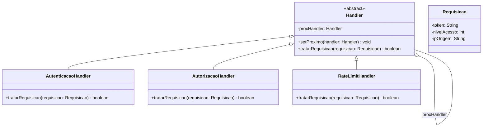

# Padrão Chain of Responsibility - Pipeline de Validação de Segurança

Implementação do padrão de projeto **Chain of Responsibility** (Comportamental) em Java. O projeto demonstra como desacoplar o remetente de uma requisição de seus receptores, permitindo que múltiplos objetos (handlers) tratem a requisição em uma sequência definida.

## Descrição

No padrão Chain of Responsibility, a requisição é passada ao longo de uma cadeia de objetos manipuladores (handlers). Cada handler decide se processa a requisição ou a passa para o próximo handler da cadeia.

### Contexto: Cibersegurança (Pipeline de Autenticação)
Neste projeto, o padrão é aplicado a um pipeline de segurança de API. Uma requisição HTTP deve passar por várias camadas de validação antes de ser processada:
1. **Autenticação:** Verifica se o token JWT é válido.
2. **Autorização:** Verifica se o usuário tem permissão para o recurso.
3. **Rate Limiting:** Verifica se o usuário não excedeu o limite de requisições.

Se qualquer camada falhar, a requisição é bloqueada imediatamente e a cadeia é interrompida.

## Estrutura do Projeto
```bash
src/
├── main/
│   └── padroescomportamentais/chain/
│       ├── Handler.java                 ⁦(Interface/Classe Abstrata do Handler)⁩
│       ├── AutenticacaoHandler.java     ⁦(Handler Concreto 1)⁩
│       ├── AutorizacaoHandler.java      ⁦(Handler Concreto 2)⁩
│       ├── RateLimitHandler.java        ⁦(Handler Concreto 3)⁩
│       ├── Requisicao.java              ⁦(Objeto da Requisição)⁩
│       └── PipelineSeguranca.java       ⁦(Cliente/Orquestrador da Cadeia)⁩
│
└── test/
└── padroescomportamentais/chain/
└── PipelineSegurancaTest.java   ⁦(Casos de teste)⁩
```

## Diagrama de Classes

O diagrama abaixo ilustra a estrutura estática do padrão. A relação-chave é a agregação de um `Handler` para outro `Handler` (`proxHandler`), que forma a cadeia.



## Análise Crítica: Vantagens e Pontos Cegos

É fundamental entender não apenas quando usar, mas **quando evitar** este padrão.

### Vantagens (Fatos)
*   **Desacoplamento:** O cliente que envia a requisição não precisa saber qual objeto específico a tratará.
*   **Princípio Aberto/Fechado (OCP):** Novos handlers podem ser adicionados à cadeia sem modificar o código do cliente ou dos handlers existentes.
*   **Responsabilidade Única (SRP):** Cada classe handler tem apenas uma responsabilidade de validação.

### Pontos Cegos e Contrapontos (Onde o padrão falha)
1.  **Desempenho (Overhead):** 
    *   *Fato:* Cada passo na cadeia adiciona uma chamada de método à pilha.
    *   *Contraponto:* Se a cadeia for muito longa (ex: 15+ validações), o overhead de performance pode ser significativo. Para validações de altíssima performance, uma única classe com `if/else` otimizado ou um compilador de regras pode ser mais eficiente.
2.  **Requisições Perdidas (Silent Failures):**
    *   *Fato:* Se a cadeia chegar ao fim e nenhum handler tratar a requisição, ela é descartada.
    *   *Contraponto:* Diferente do padrão *Observer* (onde a notificação é broadcast), no Chain of Responsibility, se você esquecer de configurar o próximo handler ou não houver um handler padrão (fallback), a requisição falha silenciosamente. **Sempre implemente um handler de fallback ou log no final da cadeia.**
3.  **Depuração (Debugging):**
    *   *Contraponto:* Rastrear por qual handler a requisição passou e onde foi bloqueada pode ser difícil sem um sistema de logs robusto, pois a lógica está distribuída em várias classes.

## Testes

O projeto contém testes unitários (JUnit 5) que validam:
*   A requisição passa por todos os handlers quando está válida.
*   A cadeia é interrompida no primeiro handler que rejeita a requisição (ex: Token inválido nem chega a verificar permissões).
*   A ordem dos handlers na cadeia afeta o resultado final.

## Tecnologias

*   **Java 21**
*   **JUnit 5**
*   **Maven**
